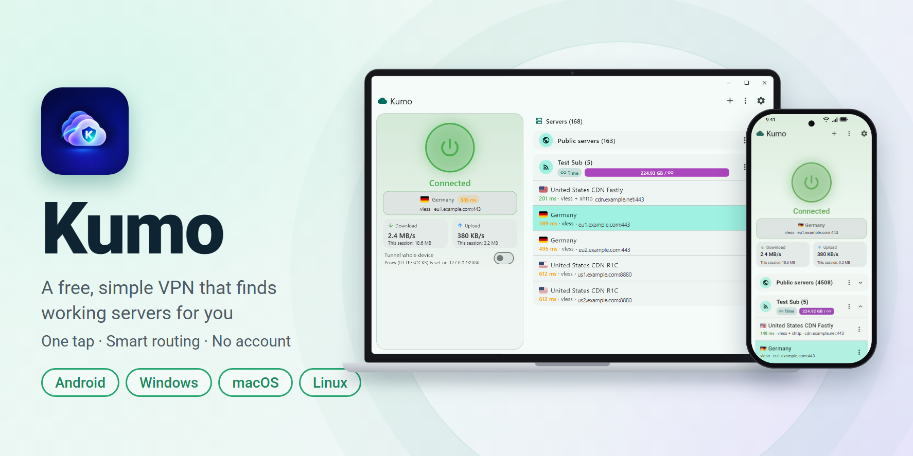

English · [فارسی](README.fa.md)

## What is Kumo?

Kumo is a free VPN app for Android, Windows, Linux and macOS. It collects public servers, tests which ones work, and connects you to the fastest with one tap. You can also add your own servers or subscriptions. It is powered by [sing-box](https://github.com/SagerNet/sing-box) and [Xray](https://github.com/XTLS/Xray-core).

## Download

<table>
  <tr><th>System</th><th>Download</th></tr>
  <tr><td>Android</td><td>
       
       
       
      
  </td></tr>
  <tr><td>Windows</td><td>
       
      
  </td></tr>
  <tr><td>macOS</td><td>
       
       
       
       
       
      
  </td></tr>
  <tr><td>Linux</td><td>
       
       
       
      
  </td></tr>
</table>

Not sure which Android file? Use **ARM64**, or **Universal** which works everywhere. Portable packages keep their data next to them.

The apps are not code-signed or on Google Play, so Play Protect, SmartScreen or Gatekeeper may warn: tap *More details → Install anyway* (Android), *More info → Run anyway* (Windows), or right-click → *Open* (macOS). Compare a file's SHA-256 with the one GitHub shows next to it in the release.

## Features

- One-tap connect, automatic fastest server, automatic switch when a server stops answering.
- Whole device (Android) or local proxy; per-app routing, direct countries, your own routing rules.
- Free public servers, your own configs and subscriptions (links, QR codes, files; Clash, sing-box, Xray and Surge formats).
- Many protocols: VLESS, VMess, Trojan, Shadowsocks, Hysteria 1 and 2, TUIC, AnyTLS, WireGuard, SOCKS, SSH and more.
- Privacy: kill switch, strict DNS, WebRTC leak block, ad and tracker block, IP and DNS leak tests.
- Speed tests, live speed and usage, widgets, tray icon, Android TV, seven languages.

## How to use

1. Open Kumo and wait for the server list to load.
2. Tap the connect button (*Automatic* picks the fastest server).
3. On Android, allow the VPN permission the first time.

## Good to know

- Public servers are run by unknown people. **Do not use them for banking or anything sensitive.**
- Kumo collects no data about you. See the [privacy policy](PRIVACY.md).

## Build from source

Flutter 3.27 (Dart 3.6): lutter pub get, lutter test. The sing-box and Xray cores are not in the repository: 	ools/fetch_unix_core.sh (Linux, macOS), 	ools/fetch_windows_core.ps1 (Windows), 	ools/build_libbox.ps1 and 	ools/build_xray.ps1 (Android). The workflow in .github/workflows/build.yml shows the full build.

## Feedback

Found a bug or have an idea? Open an [issue](../../issues).

## Disclaimer and license

Kumo does not provide servers and does not control the public servers it lists. You are responsible for following the laws where you live. The software is provided as is. Kumo is free software under the **GNU GPL v3.0** and includes parts of [sing-box](https://github.com/SagerNet/sing-box) and [sing-box-for-android](https://github.com/SagerNet/sing-box-for-android).
